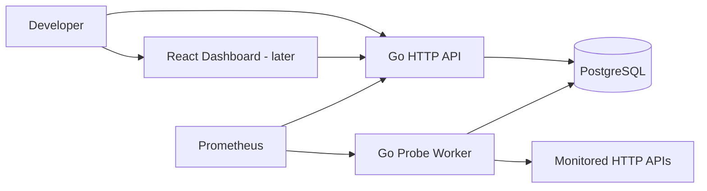

# Architecture — API Observatory

- Status: Initial architecture
- Style: Modular monolith with separately runnable API and worker processes

## 1. Context

The platform has two execution paths:
- Control plane: manages monitor configuration and exposes query APIs.
- Probe worker: executes scheduled HTTP checks and stores results.

They share domain packages and database schema but run as separate processes. This keeps deployment simple while allowing independent scaling later.

## 2. Container-level view

## 3. Main components

### API process
- HTTP routing, middleware, validation, and response mapping.
- Monitor CRUD use cases.
- Query monitor and result data.
- Health/readiness endpoints.
- Prometheus metrics endpoint.

### Worker process
- Finds monitors due for execution.
- Runs bounded HTTP probes.
- Normalizes outcomes.
- Persists results.
- Emits worker metrics and structured logs.

### PostgreSQL
- `monitors`: target configuration and schedule metadata.
- `probe_results`: immutable record of each execution.
- Future tables: alert rules, incidents, notification attempts.

### Redis (deferred)
Do not add Redis until a concrete need exists, such as distributed scheduling, queue buffering, or shared rate limiting. PostgreSQL-backed scheduling is sufficient for the first single-instance milestone.

### Prometheus
Scrapes metrics about the platform itself (request counts, request duration, probe outcomes, worker activity). Historical per-monitor results remain in PostgreSQL initially.

### OpenTelemetry
Instrument inbound HTTP requests, database operations, and worker probe execution. Exporter/backend selection is deployment configuration, not domain logic.

## 4. Key data flow

1. User creates a monitor through the API.
2. API validates and stores it.
3. Worker selects due enabled monitors.
4. Worker executes an HTTP request with timeout and redirect restrictions.
5. Worker writes a probe result and updates next execution time.
6. API serves current state and historical results.

## 5. Initial domain model

### Monitor
- `id`: UUID
- `name`: human-readable label
- `url`: HTTP(S) target
- `interval_seconds`: polling interval
- `timeout_ms`: request timeout
- `enabled`: whether checks are scheduled
- `created_at`, `updated_at`: UTC timestamps
- `next_run_at`: UTC timestamp

### ProbeResult
- `id`: UUID
- `monitor_id`: UUID
- `checked_at`: UTC timestamp
- `success`: boolean
- `status_code`: nullable integer
- `latency_ms`: nullable integer
- `error_kind`: nullable controlled category
- `error_message`: nullable sanitized short message

## 6. Reliability and concurrency

- Claim due work atomically in PostgreSQL (for example `FOR UPDATE SKIP LOCKED`).
- Set a lease/claim timestamp or claim token to recover work after worker crashes.
- Use bounded worker concurrency.
- Set explicit HTTP, database, and shutdown timeouts.
- Avoid holding database transactions open while making outbound HTTP requests.
- Make result persistence idempotent where practical.

## 7. Security boundaries

- Only allow `http` and `https`.
- Reject URL credentials and malformed hosts.
- Block loopback, private, link-local, multicast, unspecified, and reserved IP ranges.
- Resolve DNS and validate every resolved address; protect against DNS rebinding by dialing the validated IP.
- Revalidate every redirect target and limit redirect count.
- Set response body size limits.
- Do not forward ambient credentials, cookies, or internal headers.
- Sanitize error messages and never log authorization headers or secrets.
- Apply rate limits and authentication before public deployment.

## 8. Deployment topology

### Local development
- API and worker run on host via `go run`.
- PostgreSQL runs in Docker Compose.
- Prometheus can be added when metrics instrumentation lands.

### First production deployment
- API container.
- Worker container.
- Managed or containerized PostgreSQL with backups.
- Reverse proxy/TLS.
- Prometheus + Grafana as optional monitoring stack.

## 9. Evolution strategy

Extract services only when scaling, ownership, fault isolation, or deployment requirements justify the operational cost. Likely candidates: probe execution fleet, notification delivery, and analytics ingestion.
